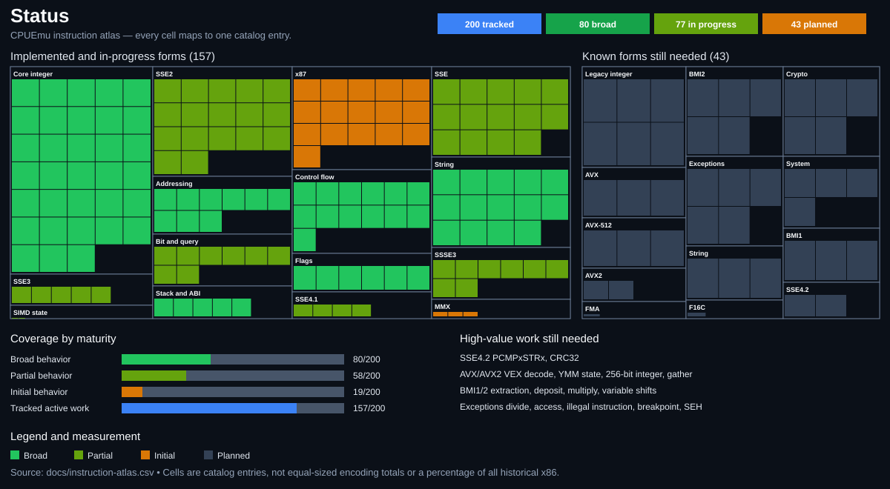
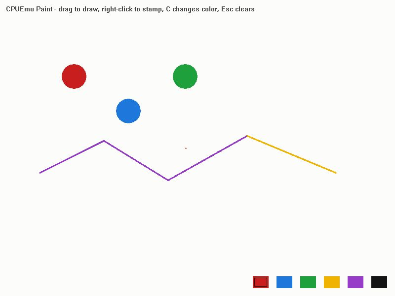
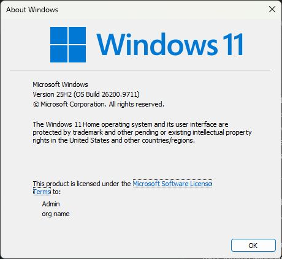
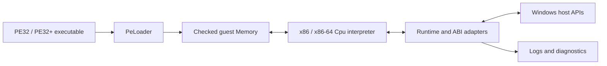

<div align="center">

# CPUEmu

### A Windows-hosted x86 / x86-64 interpreter and Win32 compatibility layer

[](#build)
[](#what-it-does)
[](#build)
[](#compatibility-snapshot)

CPUEmu loads Windows executables, interprets their machine code, isolates guest memory, and
marshals selected Windows APIs to the host. It is a user-mode compatibility project—not a virtual
machine, hypervisor, full Windows installation, or transparent native-call forwarder.

**Current headline:** Undertale loads its PE32 image, parses `data.win`, creates its GameMaker
window, completes input/display discovery, and reaches Direct3D 9Ex initialization.

</div>

---

## Compatibility snapshot

Statuses describe the furthest verified milestone, not a promise that every feature works.

| Status | Application | Architecture | Verified milestone | Next blocker |
| :---: | --- | :---: | --- | --- |
| 🟢 **Supported** | CPUEmu fixtures | x86 / x64 | Load, execute, print, and exit with checked results | Test scope only |
| 🟢 **Smoke test** | CPUEmu Paint | x64 | Creates a window and passes headless drawing self-test | Deliberately small fixture |
| 🟡 **Starts** | Classic Windows Notepad | x64 | Editor window, typing, menus, verified file loading, and Save persistence to an existing file | Save As, encoding variants, and sustained editing remain unverified |
| 🔴 **Blocked** | Modern packaged Notepad | x64 | Activates a guest-owned WinRT application instance | XAML resource lookup and guest exception unwinding |
| 🟠 **Graphics bring-up** | **Undertale** | x86 | Parses game data, creates `YYGameMakerYY`, initializes safe input, reaches `Direct3DCreate9Ex` | Direct3D 9Ex device and presentation proxy |
| 🔴 **Blocked early** | Discord / Chromium | x64 | More than 2.6M V8 startup instructions | Guest processes, threads, DLLs, exceptions, SIMD |

### Undertale milestone path

```text
PE32 load       data.win       Native HWND      Input/display       D3D9Ex        First frame
   ✅  ─────────── ✅ ──────────── ✅ ─────────────── ✅ ────────────── 🚧 ─────────── ○
313 imports     asset parse    callbacks run    safe COM proxy      current        target
```

See the full [game and application compatibility database](docs/GAME_COMPATIBILITY.md) and the
[Undertale bring-up notebook](docs/UNDERTALE.md). Commercial executables and game assets are never
stored in this repository.

## Instruction completion map

The map is an auditable catalog view. Every tiny cell maps to one named instruction, grouped
mnemonic, encoding subset, or architectural capability in
[`docs/instruction-atlas.csv`](docs/instruction-atlas.csv). “Broad” does **not** claim that every
historical encoding or edge case is complete, and the 200 tracked entries are not a denominator for
the entire x86 architecture.



The detailed [instruction inventory](docs/INSTRUCTION_COVERAGE.md) lists implemented mnemonics,
partial families, feature-advertising rules, and known gaps. CPUEmu intentionally avoids inflated
“thousands of instructions” claims: operand size, prefixes, ModRM forms, flags, and memory behavior
are all part of an instruction's implementation.

## Verified UI captures

These images were captured from windows owned by `cpuemu.exe`, not native stand-ins.

| CPUEmu Paint visual probe | Microsoft About Windows (`winver.exe`) |
| --- | --- |
|  |  |

Classic `System32\notepad.exe` now produces a genuine CPUEmu-owned editor window and accepts basic
keyboard input. Its repository screenshot is still pending; the modern packaged Notepad remains a
separate blocked target. See the [capture provenance and exact commands](docs/assets/screenshots/README.md).

## What it does

- Loads fixed or relocatable PE32 and PE32+ images with checked sections, imports, TLS metadata,
  stack setup, and low-address x86 thunks.
- Interprets x86 and x86-64 instructions with exact guest register, flag, width, prefix, and
  address-size behavior where implemented.
- Keeps guest virtual addresses separate from host pointers and validates every mapping through
  the guest `Memory` model.
- Provides explicit adapters for console, files, paths, environment, time, heap, TLS/FLS, windows,
  messages, resources, basic audio, input discovery, and selected COM-like interfaces.
- Re-enters interpreted window procedures safely instead of asking Windows to execute guest code.
- Produces leveled logs, CPU register dumps, and a 64-entry recent-instruction history on failure.

## Quick start

### Requirements

- Windows 10 or 11
- CMake 3.24+
- Ninja
- LLVM/Clang with C++20 support

### Build

```powershell
git clone https://github.com/arcwiser/cpu-emu.git
cd cpu-emu
cmake -S . -B build -G Ninja -DCMAKE_CXX_COMPILER=clang++ -DCMAKE_BUILD_TYPE=Release
cmake --build build
ctest --test-dir build --output-on-failure
```

### Run a guest

```powershell
build\cpuemu.exe C:\path\to\program.exe
```

Pass guest command-line arguments after `--`:

```powershell
build\cpuemu.exe build\test-apps\paint.exe -- --selftest
```

Limit interpreted work when probing unknown software:

```powershell
build\cpuemu.exe program.exe --limit 20000000
```

An instruction limit of `0` disables the limit. This is useful for known guests but is not
recommended for first probes.

## Logging and diagnostics

CPUEmu logs to stderr; guest stdout remains separate.

| Command | Detail | Best use |
| --- | --- | --- |
| `cpuemu.exe app.exe` | `info` | Normal runs and fast probes |
| `cpuemu.exe app.exe -v` | `api` | Every adapted API call |
| `cpuemu.exe app.exe -vv` | `trace` | Imports, mappings, and window callbacks |
| `cpuemu.exe app.exe --log-file run.log` | Mirrors logs to a file | Sharing a reproducible failure |
| `cpuemu.exe --version` | Build version | Bug reports |
| `cpuemu.exe --help` | Complete CLI usage | Option discovery |

Verbose console output can dominate runtime. Prefer `--log-file` and the default level until a
probe reaches its blocker, then rerun a narrow reproduction with `-v` or `-vv`.

## Architecture



| Component | Responsibility |
| --- | --- |
| `Cpu` | Decode, execute, registers, flags, x87/XMM state, recent instruction history |
| `Memory` | Checked guest mappings, permissions, page-indexed lookup, virtual-memory bookkeeping |
| `PeLoader` | PE validation, sections, imports, TLS, image metadata, x86/x64 format handling |
| `Runtime` | Process setup, ABI thunks, guest-owned interfaces, Win32 marshaling, callback re-entry |
| `log` | Error/warn/info/API/trace output without contaminating guest stdout |

## Compatibility principles

CPUEmu prefers a correct general mechanism over a patch for one game or instruction address.

1. **Guest pointers are untrusted.** Every range is validated before host access.
2. **Host pointers stay on the host.** Strings, arrays, structures, vtables, and nested pointers
   are copied or represented in guest memory.
3. **Callbacks re-enter the interpreter.** Guest code is never cast to a host function pointer.
4. **Unsafe features fail closed.** Unsupported asynchronous, process, thread, exception, or COM
   behavior is refused until it has a lifetime-aware adapter.
5. **Feature bits are promises.** `CPUID` advertises a family only when software can rely on it.
6. **A compatibility probe is evidence, not a test.** General behavior gets a focused regression.

## Current limitations

- One interpreted guest thread and one guest process.
- No general guest DLL loader or native 32-bit DLL execution inside the 64-bit host process.
- Direct3D 9Ex device creation/presentation is the current Undertale blocker.
- DirectInput currently exposes safe inert discovery/state behavior, not active keyboard/mouse
  delivery.
- Steam uses an offline failure path; authenticated integration needs a marshaled 32-bit helper.
- Streaming audio APIs and retained audio callbacks are not implemented.
- x87, MMX, SSE extensions, exception delivery, and many rare encodings remain incomplete.

## Repository guide

```text
cpu-emu/
├─ include/winemu/       Public core headers (legacy namespace retained for compatibility)
├─ src/                  CPU, memory, PE loader, runtime, logging, CLI
├─ tests/                Machine-code regressions and end-to-end fixtures
├─ tools/                Guest fixture source and test-app generator
├─ docs/                 Compatibility, coverage, roadmap, devlog, architecture notes
├─ .github/              Issue forms and pull-request template
├─ AGENTS.md             Rules for AI/coding agents
└─ CONTRIBUTING.md       Human and AI-assisted contribution requirements
```

For file ownership and change routing, see [Project structure](docs/PROJECT_STRUCTURE.md).

## Contributing

Instruction work, ABI fixes, Win32 adapters, tests, documentation, and reproducible compatibility
reports are welcome. Every pull request must disclose AI assistance, list exact validation results,
include appropriate tests, preserve guest/host isolation, and document limitations honestly.

Read [CONTRIBUTING.md](CONTRIBUTING.md) before opening a pull request. Coding agents must also
follow [AGENTS.md](AGENTS.md).

## Documentation

| Document | Contents |
| --- | --- |
| [Game compatibility](docs/GAME_COMPATIBILITY.md) | Status tiers, verified applications, audio status |
| [Instruction coverage](docs/INSTRUCTION_COVERAGE.md) | Detailed mnemonic/family inventory and gaps |
| [Windows compatibility](docs/WINDOWS_COMPATIBILITY.md) | Adapter ownership and supported Win32 areas |
| [Undertale roadmap](docs/UNDERTALE.md) | Current probe, milestones, and subsystem plan |
| [Roadmap](docs/ROADMAP.md) | Cross-project priorities and completion criteria |
| [Development log](docs/DEVLOG.md) | Chronological compatibility milestones |
| [Project structure](docs/PROJECT_STRUCTURE.md) | Directory responsibilities and placement rules |

---

<div align="center">CPUEmu is experimental. Compatibility claims are tied to recorded probes and the current tree.</div>
